<p align="center">
  
</p>

# gentle-teams

**Let your coding agents work as a team across repositories.**

`gentle-teams` is a [Pi](https://pi.dev) and Gentle Shell package for projects split across
several Git repositories: a frontend and its API, a library and the apps that use it, a set
of services. You keep one agent session per repository, each with its own context, and
they ask each other questions and hand each other work through a shared team, while
you stay in control of every change.


- **One agent per repository.** Each session keeps its own context and works only in its own repository.
- **Questions and change requests between sessions.** An idle session wakes up when work arrives.
- **You approve every change.** Another session's message never counts as your authorization.
- **Live team status.** See who is active, idle, or offline, and what is waiting for you.
- **Works in plain Pi and in Gentle Shell.** No server and no account: everything is local files.

> Status: early development (0.3.0). Requires Node.js 23.6 or later.

## Contents

- [Why](#why)
- [Quick start](#quick-start)
- [Use cases](#use-cases)
- [How it works](#how-it-works)
- [The `/teams` screen](#the-teams-screen)
- [Agent tools](#agent-tools)
- [Staying in control](#staying-in-control)
- [Team status](#team-status)
- [Configuration](#configuration)
- [Security model](#security-model)
- [Limitations](#limitations)
- [Updating](#updating)
- [Upgrading from pi-workspaces](#upgrading-from-pi-workspaces)
- [Development](#development)

## Why

An agent works best inside one repository, with its own instructions, tests, and history.
Real features often cross repositories: the frontend needs a new endpoint, a library change
breaks an app, two services must agree on a contract.

Opening one session on the parent folder mixes contexts and breaks per-repository tooling.
Copying messages between terminals by hand is slow, and it is easy to lose track of
who is waiting for whom.

`gentle-teams` keeps the sessions separate and gives them a structured way to talk:

| Without gentle-teams | With gentle-teams |
|---|---|
| You copy questions and answers between terminals | The frontend agent asks the backend agent directly |
| You remember which session is blocked on which | Each request has a state: requested, in progress, completed... |
| An agent in one repo edits files in another | Each agent works only in its own repository |
| A pasted message can steer the other agent | Peer messages are untrusted data; changes need your approval |

## Quick start

**1. Install**

```sh
# Gentle Shell
gentle-shell install git:github.com/alferio94/gentle-teams

# Plain Pi
pi install git:github.com/alferio94/gentle-teams
```

To try it for one session without installing:

```sh
gentle-shell -- -e /path/to/gentle-teams/extensions/teams.ts
pi -e /path/to/gentle-teams/extensions/teams.ts
```

**2. Open one session per repository**

```sh
cd ~/code/shop-api   && gentle-shell     # terminal 1
cd ~/code/shop-web   && gentle-shell     # terminal 2
```

**3. Create a team and join it**

In terminal 1, run `/teams`, press `n` to create a team (for example `shop`), then `j` to
join it. The repository folder name is proposed as the member alias (`shop-api`; you can
use `backend` instead). In terminal 2, run `/teams`, select `shop`, and press `j`.

**4. Let the agents talk**

In the frontend session, just ask:

```text
Ask the backend which fields GET /orders/:id returns, and wait for the answer
before building the order page.
```

The frontend agent sends a question with `multiagent_request`. The backend session wakes
up, answers it read-only, and the answer arrives back in the frontend session.

From then on, a session that starts in a member repository asks whether to bind to a free
member, so you only join once. Your choice is remembered for this process across `/new`,
`/resume`, `/reload`, and `/fork`; a new process asks again. Gentle Shell agent children
never bind. Leaving clears the remembered choice, so the next startup can ask again.

## Use cases

### 1. Ask about an API contract

The frontend agent needs to know a response shape, an error code, or an authentication
rule. It sends a **question**; the backend agent reads its own code and answers with
references. Answering is read-only: the backend agent cannot edit files or run commands
while answering unless you allow it (see [Staying in control](#staying-in-control)).

```text
You (frontend): Before you build the login form, ask the backend which error
codes POST /auth/login returns.
```

### 2. Request a change in another repository

The frontend needs a new endpoint. Its agent sends a **change request**; you confirm
before it is sent. In the backend terminal you see an `Accept` / `Decline` / `Later` prompt.
After you accept, the backend agent implements it in its own repository, posts progress,
and completes the request with evidence (branch, commit, PR). The frontend agent receives
the result and continues.

```text
You (frontend): We need GET /orders/:id/invoice returning a PDF URL. Request it from
the backend and continue with the UI once it is done.
```

### 3. Coordinate dependent work

A request can depend on earlier requests (`dependsOn`). For example: the backend adds a
field, then the shared types package publishes it, then the frontend uses it. Each step
is a request with its own state, so every session knows what it is waiting for. A
request can only depend on requests that already exist, so two sessions can never wait
for each other in a cycle.

### 4. A library and its consumers

The library session asks each app session whether a breaking change affects them, or
asks them to adopt a new version. Each app agent checks its own code and reports back.

### 5. Hand off a decision to the right human

When the recipient agent needs a decision only its human can make (a migration, a
product choice), it moves the request to `needs_decision` and asks in its own terminal.
The requester sees the state and waits; it never decides for the other repository.

## How it works

| Concept | What it is |
|---|---|
| **Team** | A named group of members, stored under `~/.pi/multiagent/teams/<team>`. |
| **Member** | A repository with an alias (`backend`, `frontend`). One live session at a time binds to it. |
| **Question** | Asks another member for information. Answered read-only, without an accept step. |
| **Change** | Asks another member to change its repository. Needs your confirmation to send, and the recipient's human to accept. |
| **Event** | Progress, answers, comments, and results appended to a request. |

A request moves through these states:

```text
 requested ──cancel──▶ cancelled
     ├──── decline ──▶ declined
     ▼
  accepted ── start ──▶ in_progress ⇄ needs_decision
                             │
                complete / fail
                             ▼
                    completed | failed
```

**Delivery.** Each bound session watches its team directory (with a polling fallback) and
delivers new events to its agent as a custom message, waking the session when it is idle.
The agent is never told the same event twice within a session. When the session is busy,
replies to its own requests arrive as soon as possible; other work waits for the current
turn to finish.

**Presence.** A bound session writes a heartbeat every 5 seconds. A member is `active`
while its agent is working, `idle` while waiting, and `offline` after 15 seconds without a
heartbeat. A member whose session is still alive cannot be taken over by another session.

**Storage.** Everything is plain JSON files written atomically; there is no server, no
daemon, and no network. Closed requests older than 7 days are cleaned up automatically.

## The `/teams` screen

`/teams` opens a full-screen view: one tab per team (`★` marks the team this session is
bound to), this session's row, and the members with their repository, state, and open
requests.

| Key | Action |
|---|---|
| `←` `→` | Switch team |
| `↑` `↓` | Select member |
| `n` | Create a team |
| `j` | Join the selected team with this repository and bind this session (one team per session) |
| `l` | Leave with this repository's member (blocked while it has open requests) |
| `r` | List the team's requests; `enter` shows a request's history |
| `a` / `d` | Accept or decline a change waiting for your decision |
| `p` | Remove closed requests older than 7 days, after confirming |
| `esc` | Close |

Each session can only make its own repository leave. The command needs interactive mode.

## Agent tools

Once a session is bound, its agent can use four tools:

| Tool | Purpose |
|---|---|
| `multiagent_status` | This session's binding, the members with their presence, open request counts |
| `multiagent_request` | Send a `question` or a `change` to another member, with optional `dependsOn` |
| `multiagent_inbox` | Requests this member sent or received, with their state |
| `multiagent_update` | Post progress, an answer, a comment, or a result on a request |

The agent can never accept or decline a change request. Only you can, through a prompt or
the `/teams` screen.

## Staying in control

**Sending a change.** Before a change request is sent, you choose:
`Send` (the recipient's human decides), `Send and accept on the recipient's behalf`, or
`Cancel`.

**Receiving a change.** The recipient's human sees `Accept` / `Decline` / `Later`. The agent
is told about the request only after you accept. `Later` keeps it pending and asks again
the next time the session binds.

**Answering a question.** The recipient answers read-only. `read`, `grep`, `find`, `ls`,
the four team tools, and your configured read-only tools run freely. Any other tool call,
such as `bash` or `edit`, waits while the plugin asks you **in both terminals**:

```text
backend wants to run bash while answering request ABCDEF
npm test
  Allow once / Allow for the rest of this request / Deny
```

The first answer, in either terminal, wins and the other dialog closes. Closing a dialog
denies. Only these dialogs decide: the agent in either session cannot answer them. The
command shown is cleaned of invisible and control characters, so padding cannot hide part
of it.

## Team status

While a session is bound, it shows the team at a glance.

**In Gentle Shell**, a **TEAMS** section in the fullscreen rail shows this member,
all members with colored presence, waiting approvals, and the two most recently active
requests (including closed requests), colored by state. `👥` and the accent color mark
the name of this session's team; `★` marks this member; `●` is active, `◐` idle, and `○`
offline. For example:

```text
▾ TEAMS              👥 shop
  ● frontend ★
  ◐ backend
  ○ docs
  ▸ Add invoice endpoint · in_progress
```

When the section is unavailable, the entries appear in **Integrations** instead. The
rail integration uses an internal Gentle Shell interface that may change; if it is
unavailable or incompatible, the plugin falls back to Integrations. Integrations strips
colors. **In plain Pi**, the entries appear in the footer with theme colors, shortened to
fit the terminal width.

## Configuration

Optional file: `~/.pi/multiagent/config.json`

```json
{
  "readOnlyTools": ["mem_search", "mem_context", "mem_get_observation"],
  "pruneClosedAfterDays": 7
}
```

| Key | Default | Meaning |
|---|---|---|
| `readOnlyTools` | the three Engram memory read tools shown above | Extra tools, by exact name, that run without asking while answering a question. A list replaces the default. `bash`, `edit`, and `write` are never allowed here: they are dropped with a warning. |
| `pruneClosedAfterDays` | `7` | Age in days after which closed requests (declined, cancelled, completed, failed) are removed. A request that an open request depends on, or that a member has not fully received, is kept. |

An invalid file falls back to the defaults with a warning; an invalid key falls back to
that key's default.

## Security model

Read this before using the package.

- **Peer messages are untrusted data.** They reach the agent framed as data from another
  session and never count as your authorization. A change runs only after a human
  accepts it, and an agent can never accept or decline one.
- **Answering a question is read-only.** Any other tool call waits for your answer in a
  plugin dialog, which no agent can answer.
- **Every session runs as the same operating-system user.** Teams are plain files under
  `~/.pi/multiagent`. Any process running as that user, including an agent you allowed to
  run `bash`, can read or forge those files (requests, events, approvals). The gates above
  protect against peer content steering an agent; they do not protect against a
  deliberately malicious local process. There is no real fix while all sessions share one
  user, so do not run untrusted agents or packages next to a team.
- **Request bodies and summaries are stored in clear text.** Do not put secrets in them.

## Limitations

- All sessions must run on the same machine and as the same user (shared files).
- One team per session at a time. A repository can belong to several teams.
- A completed request means the other agent reports it done, not that the repositories
  were integrated or deployed together. Verify integration yourself.
- The agent is never told the same event twice within one Pi session. Another session for
  the same member keeps its own history, and a crash while a message is queued but not yet
  recorded in the session can lose that message.

## Updating

Pi does not update packages on its own. Installed as shown in [Quick start](#quick-start),
the package follows the `main` branch; update it with:

```sh
# Gentle Shell
gentle-shell update git:github.com/alferio94/gentle-teams

# Plain Pi
pi update git:github.com/alferio94/gentle-teams
```

`--extensions` instead of the package source updates every installed package. On the next
launch after an update, Pi shows what changed from [CHANGELOG.md](CHANGELOG.md) under
"Extension Updates".

To stay on one release, install a version tag; `update` never moves a pinned tag:

```sh
gentle-shell install git:github.com/alferio94/gentle-teams@v0.1.0
```

Every release has a `vX.Y.Z` tag and a
[GitHub release](https://github.com/alferio94/gentle-teams/releases) with its notes.
Restart the sessions of a team after updating, so every member runs the same version.

## Upgrading from pi-workspaces

This package was first called `pi-workspaces`, with the command `/workspaces`.

1. Close every session still running the old version.
2. Remove the old package and install this one.
3. Start a session. It moves `~/.pi/multiagent/workspaces` to `~/.pi/multiagent/teams`
   and keeps the original as `~/.pi/multiagent/workspaces.migrated-<timestamp>`.

While a session of the old version is still running, nothing is moved and the new session
tells you so.

## Development

```sh
npm ci
npm run typecheck
npm test
```

CI (GitHub Actions) runs the typecheck and the tests on Node 23 and 24. The design, with
every decision and its reasoning, is in [docs/architecture.md](docs/architecture.md); the
release history is in [CHANGELOG.md](CHANGELOG.md).

## License

[MIT](LICENSE)
